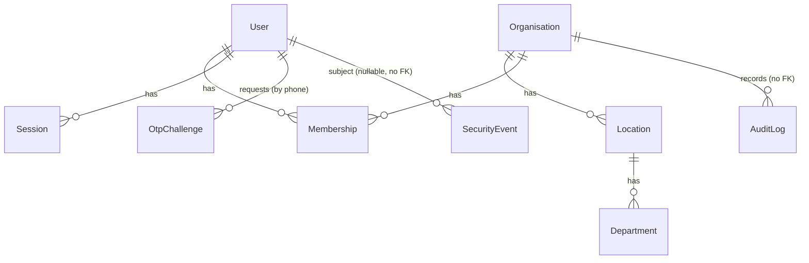
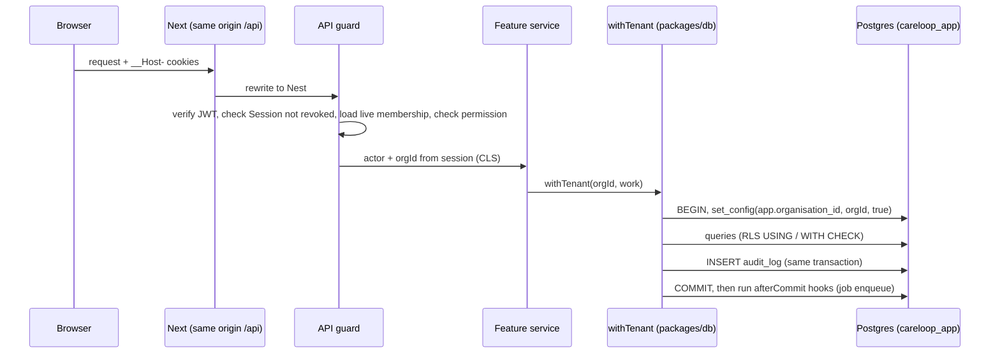
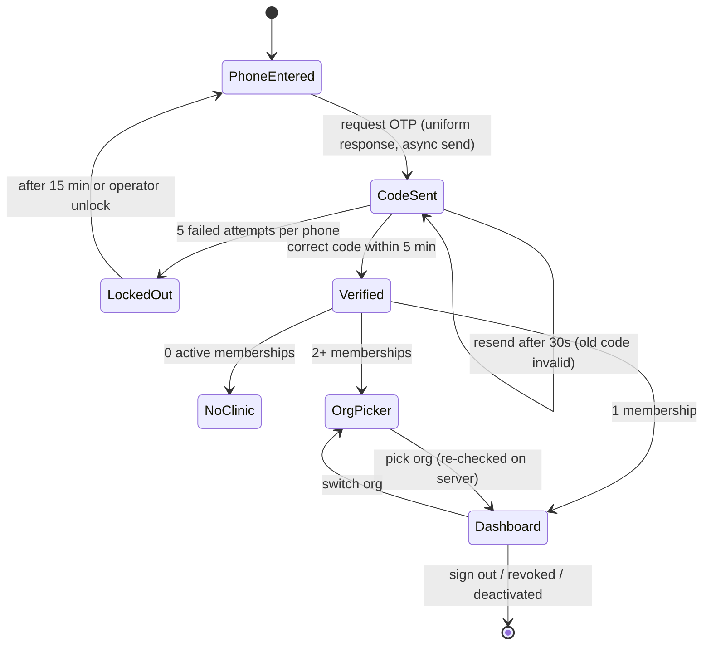

# CareLoop Foundation and Roadmap - Plan

## Goal Capsule

- **Objective:** A clinic owner, doctor and front-desk staff member from a CareLoop-created clinic can sign in with their phone, land in a professional, bilingual dashboard scoped to their own clinic, and see only what their role allows. No clinic can ever read another clinic's data, and every sensitive action leaves an audit trail.
- **Means:** Build M1 Foundation of the `claude.md` stack as a pnpm/Turborepo monorepo. Postgres row-level security enforces tenancy in the database (KTD2), sign-in is phone OTP with revocable sessions (KTD4), and the audit log is append-only (KTD3). M2–M7 are planned at roadmap level and get detailed plans when each one starts.
- **Authority:** `claude.md` hard rules override this plan. Below them come this plan's Requirements (R-IDs), then KTDs, then unit Approach text. If a unit seems to need breaking a hard rule, stop and ask.
- **Stop conditions:**
  - Stop and ask the user before adding any dependency outside the `claude.md` stack table or KTD5.
  - Stop and ask before sending patient data to a new third-party service.
  - Stop and ask before pushing to GitHub for the first time, to confirm the repo name and visibility.
  - Stop if the U4 test can't show that row-level security isolates organisations under the app database role, because everything later builds on it.
- **Execution profile:** M1 only. It ships as five PRs, grouped under Implementation Units, because `claude.md` requires one concern per PR. Conventional commits on feature branches.
- **Who finishes:** `ce-work` builds each PR group, `ce-code-review` reviews it, and `ce-commit-push-pr` opens the PR once the user has confirmed the GitHub repo.
  - After that confirmation, add a branch rule on `main` that requires the CI job.
  - If the account plan can't enforce that rule for the chosen visibility (a private repo on GitHub Free), tell the user. CI then only reports on PRs and doesn't block merges.
  - After M1, check in with the user before planning M2 in detail.

---

## Product Contract

### Summary

This plan builds CareLoop's M1 Foundation as working software. It covers:
- the monorepo and CI
- local Postgres and Redis
- organisation tenancy enforced by the database
- an append-only audit log
- phone-OTP sign-in with owner, doctor and front-desk roles
- an operator command that creates clinics
- a Tailwind-only design system built partly from 21st.dev components
- the bilingual web dashboard shell
- made-up seed data

M2–M7 are laid out as a roadmap, with the decisions research has already forced on them.

### Problem Frame

Independent Indian clinics and polyclinics run appointments, consultations, prescriptions and billing on paper, or on generic tools that don't fit how they work. CareLoop only has value if clinics trust it with patient records. One cross-clinic data leak, a WhatsApp message that names a diagnosis, or a former employee who can still sign in would end a pilot. These guarantees are cheap to build first and expensive to retrofit. The foundation therefore makes them structural (database-enforced tenancy, audited access, revocable sessions) before any patient feature exists. The repo currently holds only `claude.md`.

### Actors

- A1. Clinic owner: runs the clinic, manages staff and roles, and is often also a doctor.
- A2. Doctor: may work at more than one clinic and signs in with a single phone number.
- A3. Front-desk staff: often share a PC with colleagues.
- A4. CareLoop operator: our own staff, who create clinics and their owners through an audited command.
- A5. System: background jobs, such as reminders and PDFs, that act without a signed-in user.

### Key Decisions

- **Clinics are created by an operator, not by public sign-up.** Governs R9. (session-settled: user-directed — chosen over self-serve sign-up and over both: safer for a pilot and less to build in M1)
- **Build M1 first, then check in between milestones.** Governs R10–R16 scope. (session-settled: user-directed — chosen over building M1–M7 without stopping and over M1 only: keeps each milestone reviewable)
- **Stack dependencies and the planned schema, auth, RLS and audit work are pre-approved.** Anything outside the stack still needs approval. Helmet is approved for API security headers. (session-settled: user-directed — chosen over approving each item and over approving the plan once: avoids repeated stops while keeping out-of-stack additions gated; Helmet chosen over hand-set headers)
- **Hindi ships in M1, ahead of the M6 milestone.** Governs R16. (session-settled: user-directed — chosen over English-only until M6: M1 has few screens, so bilingual from day one is cheap)
- **The background-job worker moves to M2, where the first reminder job lands.** Governs R2. (session-settled: user-directed — chosen over scaffolding it in M1: nothing in M1 enqueues a job)

### Requirements

**Tenancy and data isolation**

- R1. Every tenant table has `organisationId` and a row-level security policy. Connected as the application's database role, organisation A reads zero rows of organisation B and cannot write rows into B.
- R2. Tenant isolation holds in every execution context: HTTP requests, the operator commands and seed scripts in M1, and background jobs from M2. No code reads tenant data across organisations except through the named cross-organisation paths in KTD2.

**Sign-in and sessions**

- R3. Staff sign in with an Indian mobile number and a one-time code. Response wording, status and timing are the same whether or not the number is registered, including when rate limits apply.
- R4. Someone who belongs to several organisations chooses one to work in after sign-in, and can switch later. The server takes the active organisation only from the session, never from anything the client sends.
- R5. Deactivating a member, changing their roles, or signing out other devices takes effect on that person's next request.

**Roles and permissions**

- R6. The API enforces owner, doctor and front-desk permissions on every endpoint, using roles loaded from the live membership. The UI hides actions a role can't take, but it is never the only check.
- R7. An owner can invite staff by phone number, change their roles and deactivate them. An organisation always keeps at least one active owner.

**Audit**

- R8. Every read or write of clinical data, and every sign-in, membership change or role change, writes an audit row. The row records the actor, actor type, action, record type, record IDs, organisation and UTC time. Audit and security-event rows hold IDs only, never patient data or raw phone numbers. The application can't update or delete them.

**Operator onboarding**

- R9. One audited command lets an operator create an organisation, its first location and the owner's membership. The owner then signs in by OTP.

**Platform**

- R10. `pnpm lint`, `pnpm typecheck` and `pnpm test` pass locally and in GitHub Actions CI, including the database-backed tests.
- R11. Every secret and environment-specific value comes from environment variables. A documented `.env.example` lists them, and local, test, staging and production configurations are kept separate.
- R12. `pnpm db:seed` creates at least two made-up demo clinics with staff in every role, contains no real patient data, and is safe to re-run.
- R13. Logs, error responses, validation errors and Redis keys never contain patient data, phone numbers or OTP codes. They carry record IDs and a request ID only.
- R14. Money is stored as integer paise and timestamps as UTC `timestamptz`, with shared helpers that display Asia/Kolkata time. Dates of birth and LMP are plain dates.

**Interface**

- R15. The web dashboard looks professional and consistent. It is styled with Tailwind only, its reusable components live in `packages/ui` (sourced from 21st.dev where a good one exists), and its animations are subtle and switch off under the device's reduced-motion setting.
- R16. All user-facing text, including built-in component text such as close buttons and screen-reader labels, goes through i18n keys with English and Hindi catalogues. Users can switch language.

### Acceptance Examples

- AE1. Covers R4. **Given** a doctor with memberships at Clinic A and Clinic B, **when** they verify their OTP, **then** they see a clinic picker. After they pick Clinic A, every API response is scoped to Clinic A until they switch, even if a request carries Clinic B's ID in a header or body.
- AE2. Covers R5, R7. **Given** an owner deactivates a front-desk member who is signed in, **when** that member makes their next request, **then** it is refused, they are signed out, and an audit row records the deactivation.
- AE3. Covers R3. **Given** an unregistered phone number, **when** someone requests codes for it repeatedly, **then** the sequence of responses matches a registered number exactly, including rate-limit responses, and no SMS is sent.
- AE4. Covers R7. **Given** an organisation with one active owner, **when** that owner tries to remove their own owner role, **then** the API refuses with a permission error.

### Success Criteria

- A new engineer can clone the repo, run Docker Compose and the documented commands, and reach a signed-in dashboard for a seeded clinic in under 15 minutes.
- The cross-organisation isolation test and the RLS catalogue check run in CI and block merges.

### Scope Boundaries

- M1 builds no patient, appointment, visit, prescription or billing features. Those arrive in M2–M4.
- No public clinic sign-up (see Key Decisions).
- No real SMS or WhatsApp sending. Development and test senders only run when `APP_ENV` is `local` or `test`.
- No cloud hosting is provisioned. Staging and production exist as configuration only until a provider is chosen (Open Questions).
- `apps/worker` is scaffolded in M2 together with the first reminder job (Key Decisions).
- `apps/mobile` and `services/ai` aren't scaffolded in M1. Mobile starts in M6, and `claude.md` marks the AI scribe as "not yet".
- Considered and not built: an idle lock for shared front-desk PCs. No M1 screen shows clinical data, so it lands in M2 with the front desk. What would change this: any M1 screen showing clinical data.
- Considered and not built: a third-party error tracker such as Sentry. CERT-In log localisation and hard rule 1 make an offshore tracker risky. Self-hosted monitoring is M7 work.
- Considered and not built: scoping memberships to particular locations. Nothing in M1 reads or enforces it, and an empty table is cheap to add with the multi-doctor front desk in M6.
- Considered and not built: bearer-token auth and 30-day mobile sessions. The mobile app starts in M6, and the transport-neutral token verifier keeps that change small.
- Considered and not built: audit-table partitioning. The primary key is shaped for it now (KTD3), and the conversion is M7 work. What would change this: audit volume in the pilot.
- Outside the product's identity (`claude.md`): pharmacy, online medicine sales, doctor marketplace, insurance claims.

#### Deferred to Follow-Up Work

- Self-serve clinic sign-up, after the pilot, if wanted.
- A real OTP provider behind the sender interface, once DLT registration exists.
- Device binding or re-verification against recycled phone numbers (`TODO(compliance)`, decision by M7). Interim mitigations: sign out other devices, owner deactivation, and an operator user-disable.

### Open Questions

- **Gates the first push, not the build:** GitHub repo name and visibility. Also needed: the `gh` CLI installed, or the repo created by hand.
- **Deferred; needed before M2 sends anything:** SMS/WhatsApp provider and TRAI DLT registration (entity, sender header, templates). This takes days to weeks, so start now.
- **Deferred; needed before staging:** an India-region hosting provider.
- **Deferred to M6:** the repo path `C:\Claude code\Doc App` contains spaces, which often breaks Android Gradle builds. Move it to something like `C:\dev\careloop` before mobile work.
- **`TODO(compliance)` questions for the user or an advisor** (also listed in PR descriptions where they touch code):
  - Is OTP-only sign-in enough for clinicians, given Indian number recycling? How should a reassigned number that matches an existing `User` be handled?
  - What is the audit-log retention period, and does storing IP addresses need a notice?
  - How long must medical records be kept before erasure is allowed (DPDP versus clinical record-keeping)?
  - May WhatsApp reminders to a shared family phone name the patient, the specialty or the doctor?
  - May the waiting-room queue screen show patient names?
  - How does guardian consent for minors and dependants work under DPDP?
  - Does GST apply to dermatology and cosmetic procedures?
  - Receipt numbering: per organisation or per location, and does it reset each financial year?
  - Must a doctor's registration number be verified before they issue prescriptions?
  - What TTL should signed PDF links have, and do patients have to verify themselves before opening one?

---

## Planning Contract

### Key Technical Decisions

- KTD1. **Each person is one global `User` (one per phone number), with a tenant-scoped `Membership` per organisation.** The `claude.md` tree `Organisation → Location → Department → User` can't model a doctor at two clinics or an owner who is also a doctor, and sign-in has to find the person before any organisation is known.
  - `Membership` carries a role set. The tree keeps modelling clinic structure. Scoping a membership to particular locations waits for the multi-doctor front desk in M6.
  - One membership per user per organisation (`UNIQUE(organisation_id, user_id)`). A re-invite reactivates the existing row.
  - Patients will never be `User` rows. `careloop_app` can read `User` without RLS, so this matters for M2.
  - The U4 PR updates the `claude.md` data-model line.
- KTD2. **Tenancy is enforced in the database: two roles, forced RLS, and a tenant setting per transaction.**
  - **Roles:** an owner role, `careloop_owner`, runs migrations. The application connects as `careloop_app`, which owns no tables. An idempotent `db:bootstrap` script creates both roles (passwords from env) before migrating. It runs in every environment, CI included; a Compose-only init script would be missing in CI and production.
    - Neither role is a superuser or has BYPASSRLS, in any environment. Local and CI then behave like a managed Postgres, where superusers aren't available.
    - `careloop_owner` gets CREATEDB only when `APP_ENV` is `local` or `test`, for Prisma's shadow database.
  - **Policies:** each tenant table calls `app.enable_tenant_rls(table)`. That one SQL function enables and forces RLS and creates `USING` and `WITH CHECK` policies against `(select app.current_org())`. `app.current_org()` is a STABLE function returning `NULLIF(current_setting('app.organisation_id', true), '')::uuid`. The `NULLIF` matters: a pooled connection returns `''` once a transaction-local setting has been used. Changing policy logic later means editing one function.
  - **Default privileges:** the owner role grants DML to `careloop_app` on future tables, so M2+ tables don't fail at runtime.
  - **Context:** each unit of work runs in one interactive transaction. `withTenant(orgId, fn)` in `packages/db` sets the context before the first query. The API, worker, operator command and seed all use it. The transaction timeout is set explicitly.
  - **Cross-org references:** parents declare `@@unique([organisationId, id])` and children reference `[organisationId, id]` in `schema.prisma`, not in hand-written SQL. Prisma would drop foreign keys it can't see. Prisma can't express optional relations this way, so a same-org trigger covers those. Relations use `onDelete: Restrict`; nothing cascades from `Organisation`.
  - **Global tables:** `User`, `OtpChallenge`, `Session` and `SecurityEvent` have no tenant policy. `Organisation` has no `organisation_id` column. It has forced RLS with policies on its own `id`, including `WITH CHECK` on insert, and sits on the catalogue allowlist under that rule.
  - **Cross-organisation paths** (the only ones):
    1. `app.user_memberships(user_id)` returns only org ID, org name, roles and status. Sign-in, the clinic picker, refresh and org switching use it.
       - It is a `SECURITY DEFINER` function owned by `careloop_owner`.
       - Forced RLS applies to table owners too, so `Membership` and `Organisation` each carry one extra read-only policy `TO careloop_owner USING (true)`. The function reads through that policy, and nothing else connects as `careloop_owner` at runtime.
    2. `withSystem(reason, fn)` is limited to global tables and requires a reason from a fixed enum.
    3. Creating an organisation: the app generates the org UUID, then runs every insert inside `withTenant(newOrgId)`. Only the `User` upsert goes through `withSystem`.
- KTD3. **Audit rows are written by an application-level writer in the same transaction as the access they record.** Postgres triggers can't capture reads, and an audit row must commit or roll back together with its action.
  - The writer accepts IDs and enums only. A list read writes one row with an array of entity IDs. A detail read or write writes one row per record.
  - The actor type is `user`, `system` or `operator`. A failed audit write fails the request (fail closed).
  - `audit_log` has primary key `(id, created_at)`, so it can be partitioned in M7 without a rewrite. It has no foreign keys in or out, which also keeps erasure possible.
  - Indexes: `(organisation_id, created_at)` and `(organisation_id, entity_type, entity_id, created_at)`.
  - Append-only: UPDATE, DELETE and TRUNCATE are revoked from `careloop_app`. A row trigger and a statement-level TRUNCATE trigger raise errors. The owner role can still pass them, for future retention jobs.
  - Pre-tenant security events, such as OTP requests, verifications, failures and lockouts, go to the global `SecurityEvent` table. It is append-only the same way and stores HMAC'd phone numbers.
  - The sign-in audit row (R8) is written to `AuditLog` once the organisation is known: when it is selected, either automatically for a single membership or through the picker. Org switches and sign-outs from an active organisation are audited the same way.
- KTD4. **OTP and session policy.**
  - **OTP:** 6 digits, stored as an HMAC with a server pepper, valid for 5 minutes. A new code invalidates the previous one.
  - **Lockout:** 5 failed attempts lock a phone for 15 minutes. Attempts count across all challenges, so a resend doesn't reset them, and they are counted atomically.
  - **Rate limits:** 30 seconds between resends, and 10 sends a day.
    - The send cap and the lockout are counted per phone-and-IP pair, so one attacker can only use up their own allowance. Stopping a known staff member from signing in would otherwise be trivial.
    - Per-phone backstops stop distributed guessing: at most 20 failed attempts and 30 sends per phone per hour, across all IPs; reaching the failure cap locks the phone until that hour ends.
    - The per-IP limit is generous (60 requests an hour), because Indian mobile carriers and clinic broadband put many staff behind one IP.
  - **Uniformity:** every counter, the lockout included, lives in Redis under HMAC'd phone keys. They are kept for every phone whether registered or not. Verifying against a phone with no challenge returns the same invalid-code response. Neither requesting nor verifying can reveal which numbers are registered.
  - **Unlock:** an operator can clear every counter for a phone (lockout, resend gap and daily caps) with an audited command.
  - **Sending:** codes are sent asynchronously after the response, through an `OtpSender` interface. The console sender and the test sender (which writes the code to a test Redis key) can only start when `APP_ENV` is `local` or `test`.
  - **Tokens:** 15-minute access JWTs carry `sid` and the active organisation, with a pinned algorithm, issuer and audience. Refresh tokens rotate and are stored hashed on the `Session` row, which also holds `activeOrganisationId`. Reusing a refresh token revokes the whole session family; a 10-second grace window keeps two tabs refreshing at once from tripping that. Refresh lasts 12 hours.
  - **Per-request checks:** every request checks that the session isn't revoked and that `User.status` is active, then loads roles from the live membership. Refreshing and switching organisation re-check the same things.
  - **Transport:** M1 is cookie-only. Both tokens travel in `__Host-` cookies (httpOnly, Secure, SameSite=Lax), which browsers require to use `Path=/`. Only the refresh route, called directly or from `proxy.ts`, accepts the refresh cookie. `token-verifier.ts` is transport-neutral, so M2 WebSockets and M6 bearer tokens for mobile can reuse it.
  - **Request hygiene:** state-changing requests must send JSON and an `Origin` matching the web origin.
- KTD5. **Versions are pinned to combinations chosen from Nov 2026 research.** U1 checks the items research couldn't confirm (see Sources and Research) before anything builds on them.
  - Node 26 LTS (26.13.1 installed on the dev machine, `.nvmrc` pins it), with `engines.node` set to `>=24.15`. pnpm 12.21 via corepack. A pnpm catalog pins React 19.3.0 everywhere.
  - TypeScript ~6.0.3, not 7.x: TS 7 has no compiler API, and typescript-eslint and the Nest CLI don't support it. Under TS 6, every tsconfig lists its `types`.
  - Prisma 7.10.1 for both CLI and client, pinned exactly, because `latest` is an 8.0 release candidate. Prisma 7 requires the `prisma-client` generator, `prisma.config.ts`, the `@prisma/adapter-pg` driver adapter and `$extends`.
  - NestJS 12, Helmet, Next.js 16.4, Tailwind 4.3, Zod 4.6, ioredis, pino, next-intl 4.15, Vitest 5.1 with `unplugin-swc`, and Playwright 1.65. BullMQ 6.7 arrives with the worker in M2.
  - Exact patch versions are fixed when the lockfile is created.
- KTD6. **Validation uses NestJS 12's built-in Standard Schema pipe with Zod schemas from `packages/shared`, not `nestjs-zod`, whose peer range stops at Nest 11.** A global pipe with a custom error factory returns field paths and error codes, never input values (R13).
- KTD7. **Packages are ESM and compiled where Node runs them.**
  - `packages/shared` and `packages/db` compile to `dist` with tsc, because NestJS and the worker run on plain Node.
  - `packages/db` also compiles its `scripts/` and `seed/` folders. The `db:*` and `ops:*` tasks depend on `build` and run with plain `node`, so no TypeScript runner is needed.
  - Phone HMAC hashing and the Redis key builders for rate limits live in `packages/db/src/security-keys.ts`. That module is Node-only, and the API and operator commands both use it, so their key formats can't drift apart.
  - `packages/ui` stays as TS source, consumed by Next through `transpilePackages`.
  - All packages are ESM, to match the Prisma 7 generated client.
  - Turbo's `dev`, `typecheck` and `test` depend on `^build`.
  - Lint enforces boundaries: `apps/web` imports `shared` and `ui` but never `db`, and `shared` uses no Node-only APIs.
- KTD8. **The UI is Tailwind v4 plus shadcn/ui in `packages/ui`, with 21st.dev components ported to Tailwind-only animation.**
  - Components found through the 21st.dev skill are copied in as source and restyled to CareLoop's tokens.
  - Every `motion` or `framer-motion` import is rewritten to Tailwind transitions or `tw-animate-css`. A lint rule bans those imports.
  - A global `prefers-reduced-motion` rule plus `motion-safe:` keeps animation optional, because `tw-animate-css` doesn't respect reduced motion on its own.
  - Built-in component text comes from a typed `UiStrings` provider, which the web fills from a next-intl `ui` namespace.
  - (session-settled: user-approved — chosen over Framer Motion: Tailwind-only styling was requested and tw-animate-css is shadcn's own animation layer)
- KTD9. **Local Postgres 16 and Redis 7 run through Docker Compose.** (session-settled: user-approved — chosen over native Windows installs of Postgres and Memurai: reproducible and matches CI service containers)
- KTD10. **Logging uses allowlist serializers, not denylist redaction.**
  - pino logs only the method, route template, status, request ID, actor IDs and error code.
  - Raw URLs, query strings, bodies, error messages and stacks are never logged in shared environments.
  - Postgres runs with `log_parameter_max_length_on_error=0` and terse error verbosity.
  - One exception filter maps errors to stable codes and never echoes Prisma messages or input values.
  - No third-party error tracker in M1 (Scope Boundaries).
- KTD11. **Web i18n uses next-intl with a locale cookie (`en`, `hi`) and no locale in the URL.** Catalogues live in `apps/web/messages/`. An ESLint rule flags string literals in JSX in both `apps/web` and `packages/ui`.
- KTD12. **Delivery uses git feature branches, one PR per concern, pushed to GitHub with GitHub Actions CI.** Whichever of two parallel PRs merges second rebases and regenerates the lockfile. (session-settled: user-directed — chosen over local-only commits and over no commits: the user wants PR-based review)
- KTD13. **Tests use Vitest across TS packages, database-backed tests against Compose or CI Postgres, and Playwright for web end-to-end.** The `claude.md` critical-path e2e grows by one step per milestone and is complete at M4. M1's e2e covers sign-in through to the dashboard.
- KTD14. **The web talks to the API same-origin, with no BFF and no CORS.**
  - The browser calls `/api/*` on the web origin. A Next rewrite handles this in dev. In production, an ingress path rule sends `/api` and `/socket.io` to Nest. This keeps cookies first-party.
  - Server components call Nest directly through a server-only module and forward the cookie header.
  - `proxy.ts` handles silent refresh, because server components can't set cookies.
  - The typed client (paths, schemas, error-code map) lives in `packages/shared/src/api/`, so mobile can reuse it.
- KTD15. **Each stored amount is an `Int` of paise, with a non-negative CHECK where that applies. Totals are computed as SQL `bigint`.** An `int` overflows at about ₹2.1 crore, which a report total can exceed. The shared money type converts between the two.

### High-Level Technical Design

Data model (M1 tables):



`User`, `OtpChallenge`, `Session` and `SecurityEvent` are global. `Organisation` has policies on its own `id`. `Location`, `Department`, `Membership` and `AuditLog` are tenant tables with forced RLS (KTD2).

Request flow through tenancy and audit:



Sign-in state flow:



### System-Wide Impact

- **Interaction graph:** web → same-origin `/api` → API guard → CLS → `withTenant`/`withSystem` → Postgres as `careloop_app`. The operator commands and seed use the same helpers, and so will the M2 worker. No path uses BYPASSRLS.
- **Error propagation:** a failed audit write fails the request. The exception filter returns an error code and request ID only. The web maps codes to `errors.*` i18n keys.
- **State lifecycle risks:**
  - Leftover tenant context on pooled connections, covered by `NULLIF` and the U5 tests.
  - Refresh-token reuse, which revokes the session family, with a grace window for concurrent tabs.
  - Deactivation while a token is live, covered by the per-request session and membership check.
  - Jobs enqueued from a transaction that rolls back, covered by `afterCommit` (built in U5, first used in M2).
- **API surface parity:** web and mobile share Zod schemas and the typed client. The guard accepts cookies and bearer tokens. M2 WebSockets reuse the token-verification service.
- **Unchanged invariants:** M1 enforces `claude.md` hard rules 1, 3, 4, 8, 9 and 10. Rules 2, 5, 6 and 7 apply from M2–M5. M1 lays down the permission seam that rule 5 will use.

### Risks and Mitigations

| Risk | Mitigation | Owner and test |
|---|---|---|
| RLS bypassed through a privileged path | Only the three cross-organisation paths in KTD2. No BYPASSRLS. No test HTTP route that returns codes. | U4 catalogue test asserts `careloop_app` lacks BYPASSRLS. U5 `withSystem` table guard. U15 uses the Redis test sender. |
| A new tenant table ships without RLS | Reversed catalogue test: every table not on the global allowlist must have `organisation_id`, forced RLS and a policy. | U4 |
| Prisma drift drops hand-written constraints | Composite FKs declared in `schema.prisma`. CI fails if `migrate diff` against the schema isn't empty. | U2, U4 |
| Patient data or phone numbers in logs | Allowlist serializers, Postgres log settings, HMAC'd keys. | U7 log-capture test with a failing query containing a phone |
| OTP enumeration or targeted lockout DoS | Uniform counters for every phone, hard limits per phone-and-IP pair, per-phone backstops, async send, operator unlock clearing every counter. | U8, U10 |
| CSRF from same-site subdomains (booking link in M2) | `__Host-` cookies, `Origin` check, JSON-only mutations. | U8 cross-origin POST test |
| Recycled phone number takes over an account | Deferred `TODO(compliance)`. Interim: sign out other devices, deactivation, and an operator user-disable that revokes every session. | U8, U9, U10 |
| JWT key misuse | Pinned algorithm, issuer and audience. Secret from env only. Rotation by key ID documented in the README. | U8 |
| Toolchain churn (TS 7, Prisma 8 RC) | Exact pins in KTD5 and a pnpm catalog. | U1 |

### Output Structure

```text
.github/workflows/ci.yml
docker-compose.yml, .env.example, vitest.config.ts
package.json, pnpm-workspace.yaml, turbo.json, tsconfig.base.json, eslint.config.mjs
apps/
  api/src/{main.ts, app.module.ts, config/, common/, auth/, memberships/, health/}
  api/test/
  web/{app/, lib/api/, i18n/, messages/{en,hi}.json, proxy.ts, playwright.config.ts, e2e/, test/}
packages/
  shared/src/{schemas/, api/, jobs/, permissions.ts, money.ts, time.ts, errors.ts}, shared/test/
  db/{prisma/schema.prisma, prisma/migrations/, prisma.config.ts, src/{client.ts, tenant.ts, audit.ts, security-keys.ts, organisations.ts}, scripts/{bootstrap-roles.ts, create-organisation.ts, unlock-phone.ts, disable-user.ts}, seed/}, db/test/
  ui/src/{components/, styles/globals.css, lib/, strings.tsx}, ui/test/
docs/plans/
```

### Assumptions

- The 21st.dev skill (`21st:21st-ui`) is reachable during U11. If it isn't, components come from shadcn/ui, are styled to match, and the PR says so.
- Organisation timezone is fixed to Asia/Kolkata, and phone numbers are `+91` E.164 only for the MVP.

---

## Implementation Units

| U-ID | Title | Key files | Depends on |
|---|---|---|---|
| U1 | Workspace and tooling scaffold | `package.json`, `pnpm-workspace.yaml`, `turbo.json`, `eslint.config.mjs`, `docker-compose.yml`, `.env.example` | none |
| U2 | CI pipeline | `.github/workflows/ci.yml` | U1 |
| U3 | Shared schemas and domain helpers | `packages/shared/src/*` | U1 |
| U4 | Database schema, roles and RLS | `packages/db/prisma/*`, `packages/db/scripts/bootstrap-roles.ts` | U1, U3 |
| U5 | Tenant and system transaction helpers | `packages/db/src/tenant.ts` | U4 |
| U6 | Audit writer and security keys | `packages/db/src/{audit.ts, security-keys.ts}` | U5 |
| U10 | Organisation creation and operator commands | `packages/db/src/organisations.ts`, `packages/db/scripts/*` | U6 |
| U14 | Seed data | `packages/db/seed/*` | U10 |
| U11 | Design system in packages/ui | `packages/ui/src/*` | U1 |
| U7 | API bootstrap, validation, logging, errors | `apps/api/src/{main.ts, common/*}` | U3, U5 |
| U8 | OTP sign-in and sessions | `apps/api/src/auth/*` | U6, U7 |
| U9 | Permission guard and membership management | `apps/api/src/{common/permissions.guard.ts, memberships/*}` | U8 |
| U12 | Web shell, sign-in, clinic picker, team page | `apps/web/*` | U9, U11 |
| U15 | E2E sign-in smoke | `apps/web/e2e/*` | U12, U14 |

### PR1: Monorepo scaffold and CI

Waits on: none.

### U1. Workspace and tooling scaffold

- **Goal:** A pnpm/Turborepo workspace where `pnpm lint`, `pnpm typecheck`, `pnpm test` and `pnpm dev` run, with local Postgres and Redis available.
- **Requirements:** R10, R11 (KTD5, KTD7, KTD9, KTD12)
- **Dependencies:** none
- **Files:**
  - Root config: `package.json`, `pnpm-workspace.yaml` (catalog plus `allowBuilds` for Prisma, esbuild and swc), `turbo.json`, `tsconfig.base.json`, `eslint.config.mjs`, `.prettierrc`, `.editorconfig`, `.nvmrc`, `vitest.config.ts` (lists packages under `test.projects`; Vitest 4+ dropped workspace files).
  - Repo hygiene: `.gitignore`, `.gitattributes` (LF line endings on Windows).
  - Environment: `.env.example`, `docker-compose.yml`.
  - Docs: `README.md`. Rename `claude.md` to `CLAUDE.md` so Linux CI and Claude Code find it.
- **Approach:**
  1. Enable pnpm through corepack via the root `packageManager` field, and set `engines.node` to `>=24.15`.
  2. Root scripts match `claude.md`, and every task runs through turbo: `dev`, `lint`, `typecheck`, `test`, `test:e2e`, `db:bootstrap`, `db:migrate`, `db:migrate:deploy`, `db:seed`, `ops:create-org`, `ops:unlock-phone`, `ops:disable-user`, `packs:validate`.
     - A task with no package implementing it is a no-op, so later PRs don't edit the root scripts.
     - `db:migrate` is `prisma migrate dev` and is for local use only. CI and deployed environments use `db:migrate:deploy` (`prisma migrate deploy`), which never prompts or resets.
     - Database, ops and e2e tasks are marked `cache: false` in `turbo.json`, because a cache hit would skip touching a fresh database. `dev` is marked `persistent`.
     - Before later units build on them, check the items research couldn't confirm (Sources and Research): corepack verifying pnpm 12, Nest 12 ESM tooling with the Prisma 7 client, and Prisma 7 `migrate dev --create-only`.
  3. Declare every M1 catalog entry and every M1 environment variable now, so later PRs don't conflict on them:
     - both database URLs
     - Redis URL
     - JWT secret, issuer and audience
     - OTP pepper and phone-hash pepper
     - `OPERATOR_ID`
     - `APP_ENV`
     - web origin
  4. ESLint flat config:
     - typescript-eslint strict
     - no `any` without a disabling comment
     - ban `motion` and `framer-motion` imports
     - ban `console.log` in apps
     - package boundary rules from KTD7
     - the JSX-literal rule from KTD11
  5. Compose runs Postgres 16 (with the KTD10 log settings) and Redis 7, on named volumes.
- **Patterns to follow:** the Commands and Layout sections of `claude.md`.
- **Test expectation:** none. This is scaffolding, verified by a smoke run.
- **Verification:** on a clean checkout, `pnpm install`, `docker compose up -d`, `pnpm lint`, `pnpm typecheck` and `pnpm test` all succeed.

### U2. CI pipeline

- **Goal:** Every PR runs lint, typecheck, database bootstrap and migrations, unit and database tests, a migration-drift check and Playwright. The workflow is written once, so later PRs never edit it.
- **Requirements:** R10
- **Dependencies:** U1
- **Files:** `.github/workflows/ci.yml`
- **Approach:**
  - Postgres 16 and Redis 7 run as service containers, with pnpm store and turbo caching.
  - Steps run in order: install, `db:bootstrap`, `db:migrate:deploy`, lint, typecheck, test, drift check, then e2e.
  - The drift check (`prisma migrate diff` from migrations to the schema must be empty) only runs once `packages/db` exists.
  - Playwright browsers install only when a Playwright config exists.
  - The workflow uses no secrets, only generated test values with `APP_ENV=test`.
- **Test expectation:** none. This is CI configuration, verified when the workflow passes on PR1.
- **Verification:** PR1's check passes on GitHub. A deliberate type error on a branch fails it.

### PR2: Shared domain, database tenancy, audit and seed

Waits on: PR1 (merge order only). This is a separate PR because `claude.md` requires one concern per PR, and this one is the schema and RLS concern.

### U3. Shared schemas and domain helpers

- **Goal:** One package of Zod schemas, constants and pure helpers, imported by the API, worker and web.
- **Requirements:** R3, R6, R13, R14 (KTD6, KTD7, KTD15)
- **Dependencies:** U1
- **Files:** `packages/shared/src/schemas/{auth.ts, membership.ts, common.ts}`, `packages/shared/src/api/{client.ts, routes.ts}`, `packages/shared/src/permissions.ts`, `packages/shared/src/money.ts`, `packages/shared/src/time.ts`, `packages/shared/src/errors.ts`, `packages/shared/test/{money.test.ts, time.test.ts, schemas.test.ts, permissions.test.ts}`
- **Approach:**
  1. The phone schema normalises to `+91` E.164 and rejects other countries. Roles are an enum: `owner`, `doctor`, `front_desk`.
  2. `permissions.ts` defines the full M1 permission vocabulary and role map as pure functions. It includes a `visit.section.*` namespace reserved for hard rule 5. U9 adds only the guard.
  3. Money is a branded integer-paise type with parse, format (₹ with Indian digit grouping) and safe add. It also handles bigint totals (KTD15). No floats.
  4. Time helpers format UTC instants in Asia/Kolkata. A separate plain-date type covers DOB and LMP.
  5. Error codes are a stable enum. The typed API client is transport-agnostic (KTD14).
  6. HMAC phone hashing lives in `packages/db` (KTD7), not in `shared`, because `shared` must stay free of Node-only APIs.
- **Test scenarios:**
  - `9876543210`, `+91 98765 43210` and `09876543210` all normalise to `+919876543210`. A `+1` number and a 9-digit number are rejected.
  - Formatting 12345678 paise gives "₹1,23,456.78". Parsing "1,234.5" gives 123450. A non-integer paise value is rejected. Summing values past 2^31 stays exact as bigint.
  - `2026-03-31T18:45:00Z` displays as 1 April 2026, 00:15 IST. A plain-date DOB round-trips without shifting.
  - An owner has `members.manage` and front desk does not. A doctor-plus-owner role set gets the union of both.
- **Verification:** the package builds to `dist` and its tests pass.

### U4. Database schema, roles and RLS

- **Goal:** The M1 schema with forced RLS on every tenant table, separate owner and app roles, the cross-organisation lookup function, and append-only audit and security-event tables.
- **Requirements:** R1, R2, R8 (KTD1, KTD2, KTD3)
- **Dependencies:** U1, U3
- **Files:**
  - Schema and config: `packages/db/prisma/schema.prisma`, `packages/db/prisma.config.ts`, `packages/db/scripts/bootstrap-roles.ts`.
  - Migrations: `packages/db/prisma/migrations/<ts>_init/migration.sql`, `packages/db/prisma/migrations/<ts>_rls/migration.sql`.
  - Tests: `packages/db/test/{rls.test.ts, rls-catalog.test.ts, user-memberships.test.ts, append-only.test.ts}`.
  - Docs: `CLAUDE.md` (data-model line, KTD1).
- **Approach:**
  1. Models: `User` (phone unique, status), `OtpChallenge`, `Session` (`activeOrganisationId`, family, `revokedAt`), `SecurityEvent`, `Organisation`, `Location`, `Department`, `Membership` (roles array, status) and `AuditLog`.
     - Keys and types: UUID IDs, `timestamptz` timestamps, snake_case mapping.
     - Uniqueness: `UNIQUE(organisation_id, name)` on locations, `UNIQUE(location_id, name)` on departments, `UNIQUE(organisation_id, user_id)` on memberships.
     - CHECK constraints: roles are non-empty and contain no duplicates.
     - Staff and structure rows are never hard-deleted; they carry a status or `archivedAt`.
  2. Composite foreign keys go in `schema.prisma` (KTD2). A same-org trigger covers optional relations.
  3. The RLS migration is hand-written SQL created with `migrate dev --create-only`. It defines:
     - `app.current_org()` and `app.enable_tenant_rls()`
     - `app.user_memberships()` and its owner-only read policies (KTD2)
     - `Organisation`'s id-based policies
     - default privileges and grants
     - the append-only revokes and triggers
  4. Migrations connect with the owner URL from `prisma.config.ts`. The runtime client uses `careloop_app` through the pg adapter.
- **Execution note:** Write the isolation tests first and run them as `careloop_app`. If isolation can't be shown, stop (Goal Capsule).
- **Test scenarios:**
  - In org A's context, selecting all `Location` and `Membership` rows returns only A's rows. In B's context, A's IDs return zero rows.
  - With no context set, tenant tables return zero rows and inserts fail.
  - With the context set to `''`, as on a reused pooled connection, queries return zero rows without a cast error.
  - In A's context, an UPDATE that sets `organisation_id` to B fails, which exercises `WITH CHECK`.
  - In A's context, inserting a `Department` under a location that belongs to org B fails on the composite foreign key.
  - Catalogue:
    - Every table not on the global allowlist has `organisation_id`, `relforcerowsecurity = true` and at least one policy.
    - `organisation` meets its own allowlist rule: forced RLS with id-based policies.
    - A fixture table without a policy makes this test fail.
    - `careloop_app` has neither BYPASSRLS nor ownership of any table.
    - Neither `careloop_app` nor `careloop_owner` is a superuser or has BYPASSRLS.
  - With both roles non-superuser, `app.user_memberships(user)` returns the shared doctor's two memberships with org names and nothing else from either org.
  - As `careloop_app`, UPDATE, DELETE and TRUNCATE on `audit_log` and `security_event` all fail.
  - A table created by a later migration is usable by `careloop_app` without an explicit grant, which proves the default privileges.
- **Verification:** `db:bootstrap` followed by `db:migrate:deploy` applies cleanly to an empty database and is idempotent on re-run. All tests pass against Compose Postgres.

### U5. Tenant and system transaction helpers

- **Goal:** One way to run database work in a tenant or system context, shared by the API, worker, operator commands and seed.
- **Requirements:** R2 (KTD2)
- **Dependencies:** U4
- **Files:** `packages/db/src/client.ts`, `packages/db/src/tenant.ts`, `packages/db/src/index.ts`, `packages/db/test/tenant.test.ts`
- **Approach:**
  - `withTenant(orgId, fn)` opens an interactive transaction with an explicit timeout and sets the context first. It hands `fn` a transaction client and an `afterCommit(cb)` registrar. Callbacks registered there run only after the commit.
  - `withSystem(reason, fn)` gives `fn` a client restricted to global-table models, plus a call to `app.user_memberships`.
  - The raw client isn't exported, and lint's `no-restricted-imports` blocks deep imports.
- **Test scenarios:**
  - Concurrent `withTenant` calls for A and B on one pool each see only their own rows.
  - An error inside `fn` rolls back its writes, skips `afterCommit` callbacks, and leaves no context on the connection.
  - Nesting `withTenant` with a different org throws.
  - Touching a tenant model through the `withSystem` client throws.
- **Verification:** the tests pass, and the package's public exports contain only helpers and types.

### U6. Audit writer and security keys

- **Goal:** Functions that record audit rows and security events inside the caller's transaction, plus the one shared source of phone hashes and rate-limit keys.
- **Requirements:** R8, R13 (KTD3, KTD7)
- **Dependencies:** U5
- **Files:** `packages/db/src/audit.ts`, `packages/db/src/security-events.ts`, `packages/db/src/security-keys.ts`, `packages/db/test/{audit.test.ts, security-keys.test.ts}`
- **Approach:**
  - `audit(tx, entry)` takes the organisation from the transaction context. Its entry type allows only IDs, enums and an `entityIds` array for list reads, with no free-text field.
  - `securityEvent(tx, entry)` takes an already-hashed phone, never a raw one.
  - `security-keys.ts` HMACs a normalised phone with the pepper from config. It also builds the Redis keys for KTD4's counters (per phone-and-IP, per phone, per IP).
- **Test scenarios:**
  - A write and its audit row inside `withTenant` both commit. When `fn` throws later in the transaction, neither commits.
  - When the audit insert fails (forced through a constraint), the whole transaction fails.
  - An audit row written under org A is invisible under org B.
  - A system actor's row has `actorType: system` and no user ID.
  - A list read records one row with every returned ID.
  - Two spellings of the same phone produce the same hash and keys. The keys contain no phone digits.
- **Verification:** the tests pass.

### U10. Organisation creation and operator commands

- **Goal:** One `createOrganisation` function that the operator command and the seed both use, plus audited commands to clear a phone's OTP limits and to disable a user.
- **Requirements:** R9, R8, R2, R5 (Key Decisions, KTD2 cross-organisation path 3, KTD4)
- **Dependencies:** U6
- **Files:** `packages/db/src/organisations.ts`, `packages/db/scripts/create-organisation.ts`, `packages/db/scripts/unlock-phone.ts`, `packages/db/scripts/disable-user.ts`, `packages/db/test/{create-organisation.test.ts, operator-commands.test.ts}`
- **Approach:**
  - `createOrganisation` accepts an optional org ID and generates one only when none is passed; the seed passes its fixed IDs.
    - It upserts the owner `User` via `withSystem`.
    - Inside `withTenant(orgId)` it upserts the organisation, location and owner membership. An audit row with `actorType: operator` is written only when something was inserted.
  - The operator's identity is a fixed UUID from the `OPERATOR_ID` environment variable, recorded as the audit actor. No name is stored. Commands refuse to run without it and print IDs only.
  - `unlock-phone` clears every KTD4 counter for that phone, using the U6 key builders.
  - `disable-user` sets `User.status` to disabled, revokes all of that user's sessions through `withSystem`, and records a `SecurityEvent`.
- **Test scenarios:**
  - The command creates exactly one organisation, one location and one owner membership, plus one operator audit row.
  - An owner phone that already exists links to the existing `User` rather than creating a duplicate.
  - Running it twice with the same org ID creates nothing new and writes no second audit row.
  - Missing arguments, or a missing `OPERATOR_ID`, exit non-zero and write nothing.
  - After a phone hits the lockout and the daily send cap, unlock lets a new code be requested and verified, and records a `SecurityEvent`.
  - After `disable-user`, the user's next request and their refresh both fail in every organisation.
- **Verification:** the tests pass, and the new owner can sign in through U8 once PR4 lands.

### U14. Seed data

- **Goal:** `pnpm db:seed` creates two made-up demo clinics with staff in every role.
- **Requirements:** R12, R2
- **Dependencies:** U10
- **Files:** `packages/db/seed/index.ts`, `packages/db/seed/fixtures.ts`, `packages/db/test/seed.test.ts`
- **Approach:**
  - Seeds "Sunrise Family Clinic" (one location, a GP department) and "Lotus Polyclinic" (two locations, three departments).
  - Phone numbers come from a clearly fake, documented block. One doctor belongs to both clinics.
  - Rows use fixed literal UUIDs and are upserted by ID through `createOrganisation` and `withTenant`.
  - Audit rows are written only when a row is actually inserted.
  - The seed refuses to run unless `APP_ENV` is `local` or `test`.
- **Test scenarios:**
  - Running the seed twice leaves the same non-audit row counts and adds no audit rows on the second run.
  - The shared doctor has two memberships.
  - The seed exits non-zero under `APP_ENV=staging`.
- **Verification:** after seeding, the dashboard (U12) lists both clinics for the shared doctor.

### PR3: Design system

Waits on: PR1 (merge order only). This is a separate PR because `claude.md` requires one concern per PR. It doesn't conflict with PR2.

### U11. Design system in packages/ui

- **Goal:** A professional, consistent component kit and theme, styled with Tailwind only.
- **Requirements:** R15, R16 (KTD8, KTD11)
- **Dependencies:** U1
- **Files:**
  - Config and styles: `packages/ui/components.json`, `packages/ui/src/styles/globals.css` (Tailwind v4 `@theme` tokens, `@source` for app packages, `tw-animate-css`, the reduced-motion rule).
  - Helpers: `packages/ui/src/lib/cn.ts`, `packages/ui/src/strings.tsx`.
  - Components in `packages/ui/src/components/`: `button.tsx`, `input.tsx`, `otp-input.tsx`, `card.tsx`, `dialog.tsx`, `dropdown-menu.tsx`, `toast.tsx`, `skeleton.tsx`, `badge.tsx`, `avatar.tsx`, `table.tsx`, `sidebar.tsx`, `page-header.tsx`, `empty-state.tsx`.
  - Tests: `packages/ui/test/{button.test.tsx, otp-input.test.tsx, strings.test.tsx}`.
- **Approach:**
  1. Initialise with the shadcn CLI in monorepo mode. CareLoop's tokens:
     - a calm clinical palette: teal primary, neutral surfaces
     - light and dark modes
     - Inter plus Noto Sans Devanagari
     - 4/8 px spacing
  2. For the sidebar, OTP input, empty state, page header and sign-in card, search 21st.dev with the `21st:21st-ui` skill. Copy in the best match and port its animation as KTD8 describes.
  3. Content text arrives through props. Built-in text (close, dismiss, cell labels, busy state, collapse) comes from `UiStrings`.
  4. Animations: 150–250 ms ease-out fades and slides on overlays, toasts and page transitions. All are wrapped in `motion-safe:`.
  5. Accessibility and responsive baseline:
     - Below `lg`, the sidebar becomes an off-canvas drawer.
     - Primary actions have a touch target of at least 44 px.
     - Focus rings are visible, and both themes meet WCAG AA contrast.
     - Dialogs and menus trap focus and work by keyboard.
     - Form errors are linked to their inputs with `aria-describedby`.
     - The OTP input sets `autocomplete="one-time-code"` and has an error state.
- **Test scenarios:**
  - Pasting "123456" into the OTP input fills all six cells. Backspace moves focus back a cell. Non-digits are refused.
  - A Button with `loading` is disabled and announces a busy state.
  - Rendering a Dialog without a `UiStrings` provider fails loudly in tests.
  - Lint fails when a component imports `framer-motion`.
- **Verification:**
  - The tests pass.
  - A dev-only preview page in `apps/web`, added in U12, renders every component in both themes.
  - Animations stop when reduced motion is emulated.
  - An axe check of the preview page reports no serious violations.

### PR4: API foundation, sign-in and roles

Waits on: PR2 (merge order only). This is a separate PR because `claude.md` requires one concern per PR, and auth is a gated concern.

### U7. API bootstrap, validation, logging, errors

- **Goal:** A NestJS 12 app with the global safety rails every later feature relies on.
- **Requirements:** R10, R11, R13 (KTD6, KTD10, KTD14)
- **Dependencies:** U3, U5
- **Files:** `apps/api/src/main.ts`, `apps/api/src/app.module.ts`, `apps/api/src/config/env.ts`, `apps/api/src/common/{validation.ts, exception.filter.ts, logger.ts, request-context.ts, origin.guard.ts}`, `apps/api/src/health/health.controller.ts`, `apps/api/test/{validation.e2e.test.ts, errors.e2e.test.ts, logging.e2e.test.ts, health.e2e.test.ts}`
- **Approach:**
  1. Parse env with Zod at startup. On failure, exit with the variable name only.
  2. CLS carries the request ID, actor, session ID and active organisation.
  3. A global Standard Schema pipe returns errors without the submitted values.
  4. One exception filter maps errors to codes. Anything unmapped becomes a 500 with the request ID only.
  5. pino uses allowlist serializers.
  6. Helmet is on, CORS is off, and an Origin and JSON check applies to mutations.
- **Test scenarios:**
  - POSTing an invalid phone returns 400 with the field path and error code. The body doesn't contain the submitted value.
  - A failing query whose parameters include a phone returns 500 with a request ID. No captured log line contains any digits of that phone.
  - A request with a phone number in its query string logs only the route template.
  - A cross-origin POST, or a POST that isn't JSON, is rejected.
  - Starting without `DATABASE_URL` exits with a message naming that variable.
  - `GET /health` returns OK when the database and Redis are up, and 503 when Redis is down.
- **Verification:** the tests pass, and the app boots with `pnpm --filter api dev`.

### U8. OTP sign-in and sessions

- **Goal:** Staff sign in by phone OTP and get revocable sessions, with organisation selection.
- **Requirements:** R3, R4, R5, R8, R13 (KTD2 cross-organisation path 1, KTD4)
- **Dependencies:** U6, U7
- **Files:** `apps/api/src/auth/{auth.module.ts, auth.controller.ts, otp.service.ts, session.service.ts, token-verifier.ts, otp-sender.ts, console-otp-sender.ts, test-otp-sender.ts, rate-limit.ts}`, `apps/api/test/auth/{otp.e2e.test.ts, enumeration.e2e.test.ts, session.e2e.test.ts, org-switch.e2e.test.ts}`
- **Approach:**
  1. `POST /auth/otp/request`: uniform response, limits applied to every phone, asynchronous send.
  2. `POST /auth/otp/verify`: issues the session and cookies, and returns memberships from `app.user_memberships`.
  3. `POST /auth/org/select`: re-checks the membership and updates `Session.activeOrganisationId`.
  4. `POST /auth/refresh`: rotation with reuse detection and a grace window.
  5. `POST /auth/logout` and `POST /auth/logout-others`.
  6. `token-verifier.ts` is transport-neutral, so M2's WebSocket handshake can reuse it.
  7. Every outcome writes a `SecurityEvent`. Selecting an organisation also writes the sign-in `AuditLog` row (KTD3).
  8. Counters and key formats come from U6's `security-keys.ts`.
- **Test scenarios:**
  - Covers AE3. Twelve consecutive requests for a registered phone and an unregistered phone give identical status-and-body sequences. Only the registered phone gets a challenge.
  - The right code within 5 minutes signs the user in. The same code reused fails, and so does a code at 5 minutes and 1 second.
  - After a resend, the earlier code is rejected.
  - Five wrong attempts from one IP lock that phone for that IP. A resend doesn't reset the count. Ten parallel wrong guesses record at most five attempts. The correct code is refused from that IP until 15 minutes pass on the fake clock.
  - Covers AE3. Seven wrong verify attempts produce identical status-and-body sequences for a registered phone and an unregistered phone, including the lockout response.
  - An attacker IP that exhausts a phone's lockout and send cap doesn't stop the same phone signing in from a different IP. The per-phone backstop still stops guessing spread across many IPs.
  - A resend within 30 seconds is rejected, and so is the 11th send in a day from one IP. The per-IP limit triggers across different phones.
  - Both cookies are set with the `__Host-` prefix and `Path=/`. Refresh succeeds when called from `proxy.ts`.
  - Selecting an organisation writes an `AuditLog` sign-in row scoped to that organisation.
  - Covers AE1. A user with two memberships gets the org list at verify. Before an org is selected, calls return 403 `org_not_selected`. A request carrying org B's ID in a header or body stays scoped to the selected org A.
  - Selecting an org where the user has no active membership is refused.
  - Refresh rotates the token. Reusing an old refresh token after the grace window revokes the family. Two refreshes inside the grace window both succeed.
  - After `logout-others`, the other session's next request fails.
  - The console and test senders refuse to start under `APP_ENV=staging` and `APP_ENV=production`.
- **Verification:** the tests pass. A manual sign-in with a seeded phone prints the code to the API console under `APP_ENV=local`.

### U9. Permission guard and membership management

- **Goal:** API-enforced role permissions, with owners managing their staff.
- **Requirements:** R5, R6, R7, R8 (KTD1, KTD4)
- **Dependencies:** U8
- **Files:** `apps/api/src/common/permissions.guard.ts`, `apps/api/src/common/permission.decorator.ts`, `apps/api/src/memberships/{memberships.module.ts, memberships.controller.ts, memberships.service.ts}`, `apps/api/test/{memberships.e2e.test.ts, permissions-coverage.test.ts}`
- **Approach:**
  - A global guard, registered in the same commit as the first non-public route, reads `permissions.ts` from U3.
  - It denies by default. Routes fall into three kinds:
    - `@Public`, a fixed allowlist: OTP request, OTP verify, refresh and health.
    - `@SessionOnly`: org select, logout, logout-others. These need a live session but no organisation or permission.
    - Everything else needs a live session, a selected organisation (otherwise 403 `org_not_selected`) and the declared permission.
  - Memberships support list, invite by phone (creating or linking a `User`, or reactivating an existing membership), change roles, deactivate and reactivate.
  - Deactivation revokes the member's sessions whose active organisation is this one, and blocks re-selecting it.
  - Every change is audited.
- **Test scenarios:**
  - Front desk calling invite gets 403. An owner gets 201 and an audit row is written.
  - Covers AE4. The last active owner removing their own owner role, or deactivating themselves, is refused.
  - Covers AE2. After deactivation, the member's next request fails and refresh fails.
  - A member active in org B and deactivated in org A keeps access to B but can't switch to A.
  - A role downgrade from owner to front desk blocks the very next owner-only request.
  - Owner A patching a membership ID that belongs to org B gets 404, and nothing changes.
  - Inviting a phone that's already an active member returns 409. Inviting a deactivated member reactivates them. Inviting a phone that's a member elsewhere creates a second membership on the existing `User`.
  - Coverage test:
    - Every registered route has a permission decorator, `@SessionOnly`, or a place on the `@Public` allowlist.
    - An undecorated route fails the test.
    - A `@Public` route that isn't on the allowlist also fails it.
  - A `@SessionOnly` route called without a session returns 401.
- **Verification:** the tests pass.

### PR5: Web dashboard

Waits on: PR3 (merge order only). Also waits on PR4, which must merge before this group's e2e can run, because sign-in calls the API. This is a separate PR because `claude.md` requires one concern per PR.

### U12. Web shell, sign-in, clinic picker, team page

- **Goal:** The signed-in M1 experience: sign-in, clinic picker, dashboard shell, team management and language switch.
- **Requirements:** R3, R4, R6, R7, R15, R16 (KTD4, KTD11, KTD14)
- **Dependencies:** U9, U11
- **Files:**
  - Auth pages: `apps/web/app/(auth)/layout.tsx` (with the language toggle), `apps/web/app/(auth)/sign-in/page.tsx`, `apps/web/app/(auth)/choose-clinic/page.tsx`, `apps/web/app/(auth)/no-clinic/page.tsx`.
  - App pages: `apps/web/app/(app)/layout.tsx`, `apps/web/app/(app)/page.tsx`, `apps/web/app/(app)/team/page.tsx`, `apps/web/app/(app)/not-permitted/page.tsx`, `apps/web/app/(app)/settings/language/page.tsx`.
  - Dev preview: `apps/web/app/dev/components/page.tsx`.
  - Plumbing: `apps/web/proxy.ts`, `apps/web/next.config.ts` (rewrites, `transpilePackages`), `apps/web/lib/api/{server.ts, browser.ts}`, `apps/web/i18n/request.ts`.
  - Messages and tests: `apps/web/messages/{en.json, hi.json}`, `apps/web/test/i18n-keys.test.ts`.
- **Approach:**
  - Server components are the default. Client components are used only for the OTP form, dialogs and the language switcher.
  - `proxy.ts` handles:
    - redirecting signed-out users to sign-in
    - sending users with no active membership to `no-clinic`, which shows one neutral message and a sign-out button whatever the cause
    - redirecting users who haven't picked a clinic to the picker
    - silent refresh
  - **Losing a session:** when refresh fails or the API reports the session revoked, `browser.ts` shows an error toast, then redirects to `/sign-in?reason=signed_out`. The sign-in page shows a matching notice that reveals nothing about the account.
  - API error codes map to `errors.*` keys.
  - **Sign-in screen states**, each with its own i18n key:
    - idle
    - sending
    - code sent, with a 30-second resend countdown
    - verifying
    - wrong or expired code
    - locked or rate-limited: one neutral message for every limit, so the screen never shows whether a number is registered
  - **Navigation:** Home for every role, and Team for owners. A user menu holds language and sign-out. When the user has two or more memberships, the header shows the active clinic with a switcher linking to `/choose-clinic`.
  - **Team page** (owners only; U9 enforces the same rule in the API):
    - An invite dialog with phone and role checkboxes, showing the 409 and invalid-phone errors inline.
    - Role edits happen in a dialog. Deactivating someone or downgrading their role asks for confirmation.
    - Refusing to remove the last owner shows an inline `errors.*` message.
    - The table has skeleton, empty and error states. Success shows a toast.
  - A front-desk user who opens an owner-only URL sees `not-permitted`.
  - The home page shows the clinic name, the user's roles, and empty-state cards for features coming in M2–M4.
- **Test scenarios:**
  - Every key in `en.json` also exists in `hi.json`, and the other way round.
  - Every `ErrorCode` has an `errors.*` key in both languages.
  - A signed-out request to `/team` redirects to `/sign-in`.
  - A session with zero active memberships is redirected to `/no-clinic`.
  - Switching language on the sign-in page sets the same locale cookie that the settings page uses.
  - The dev components page returns 404 unless `APP_ENV=local`.
- **Verification:** sign in manually as each seeded role and check:
  - each role sees the right navigation
  - switching to Hindi shows translated UI
  - as owner, inviting and deactivating a member works

### U15. E2E sign-in smoke

- **Goal:** The first slice of the `claude.md` critical path in Playwright, which later milestones extend.
- **Requirements:** R10, R3, R4, R6 (KTD13)
- **Dependencies:** U12, U14
- **Files:** `apps/web/playwright.config.ts`, `apps/web/e2e/critical-path.spec.ts`, `apps/web/e2e/helpers/otp.ts`
- **Approach:**
  - Under `APP_ENV=test`, the U8 test sender writes each code to a short-lived Redis key, and the Playwright helper reads it directly from Redis.
  - No HTTP route exposes codes.
  - Tests run against seeded data.
- **Test scenarios:**
  - The seeded owner signs in, lands on the dashboard, opens Team and sees the seeded staff.
  - The shared doctor signs in, sees the clinic picker, chooses Lotus Polyclinic, and the header shows Lotus.
  - Front desk signs in and has no Team link. Visiting `/team` directly shows a not-permitted page.
- **Verification:** `pnpm test:e2e` passes locally and in CI.

---

## Later Milestones (planned in detail when each starts)

Each milestone gets its own `ce-plan` run that reuses this plan's KTDs. Research has already settled these points:

- **M2 Front desk** (patients, appointments, tokens, live queue, booking link, WhatsApp reminders)
  - Scaffold `apps/worker` (BullMQ 6). Queue names and ID-only payload schemas live in `packages/shared/src/jobs/`. A `defineJob` wrapper runs every handler in `withTenant`, and schedules use `upsertJobScheduler`.
  - Bring forward a minimal consent record (WhatsApp opt-in and DPDP notice) from M7, because reminders ship in M2.
  - Add the 15-minute idle lock for shared PCs.
  - Socket.IO authenticates through U8's token verifier. Rooms are per organisation and per location, and a socket is evicted when its user is deactivated or switches organisation.
  - Token numbers use a per-org counter row locked with `FOR UPDATE`.
  - Reminder jobs are enqueued through `afterCommit`.
  - Reminder templates carry no clinical content (hard rule 2).
  - Patients are tenant rows, never `User` rows.
  - Needs a messaging provider and DLT registration first.
- **M3 Consultation** (visit screen, medicine DB, prescription builder and PDF, follow-ups, observations)
  - Ship a built-in `core/1` pack so `Visit.specialtyPackId` can be filled before M5.
  - Restricted visit sections use the `visit.section.*` permissions and a response filter (hard rule 5).
  - PDFs sit behind signed, expiring links.
  - Capture each doctor's registration number and council.
  - Write `Observation` rows alongside `visitData`.
- **M4 Billing and reports** (charges, receipts, UPI QR, day-end summary, reports, subscriptions)
  - Money follows KTD15, with tests built on worked examples.
  - Receipt numbers use a counter row locked with `FOR UPDATE`.
  - GST fields wait on the `TODO(compliance)` answer.
  - Completes the critical-path e2e: register patient → book → visit → prescription → bill → reminder queued.
- **M5 Specialty packs** (pack format, validator, form renderer, the 4 MVP packs)
  - Follow `.claude/rules/specialty-packs.md`.
  - `pnpm packs:validate` becomes a real check.
  - No field may reveal foetal sex (hard rule 7).
- **M6 Mobile and polyclinic desk** (Expo doctor mode, packs on mobile, multi-doctor front desk, data import, Hindi)
  - Move the repo to a path without spaces first.
  - Mobile styling needs a decision: NativeWind 4 (Tailwind v3), or wait for NativeWind 5 (Tailwind v4).
  - The mobile app uses bearer tokens, added to the guard through U8's token verifier, along with a longer mobile refresh lifetime and the shared typed client.
  - Add location-scoped memberships for the multi-doctor front desk.
  - Expo SDK 58 doesn't need a hoisted linker.
- **M7 Pilot hardening** (security fixes, consent log, data export and erasure, monitoring, backup drill)
  - Patient erasure means anonymising, with ID-only audit rows kept.
  - Partition the audit log.
  - Self-hosted monitoring in an India region.
  - Decide the defence against recycled phone numbers.
  - The DPDP Rules duties apply from about May 2027.

---

## Verification Contract

| Gate | Command | When |
|---|---|---|
| Local services | `docker compose up -d` | Before any database test |
| Database roles | `pnpm db:bootstrap` | Fresh database, CI, and every environment before migrating |
| Migrations | `pnpm db:migrate` locally; `pnpm db:migrate:deploy` in CI, staging and production | After U4 and on every schema change |
| Migration drift | Prisma migrate diff (CI step from U2) | Every PR after PR2 |
| Lint | `pnpm lint` | Every unit |
| Types | `pnpm typecheck` | Every unit |
| Unit and database tests | `pnpm test` | Every unit, including the RLS, catalogue and audit tests |
| Seed | `pnpm db:seed` | After U14, and before e2e |
| End-to-end | `pnpm test:e2e` | U12, U15, and every PR5 change |
| Pack validation | `pnpm packs:validate` | Placeholder in M1, real in M5 |
| Review | `ce-code-review` on each PR group | Before opening each PR |

---

## Definition of Done

- `pnpm lint && pnpm typecheck && pnpm test` pass locally and in CI. `pnpm test:e2e` passes for PR5.
- Every tenant table has forced RLS and a policy, and the isolation and catalogue tests cover it (R1).
- The permission-coverage test covers every endpoint (U9).
- No log line, error body, Redis key or test fixture contains real patient data, real phone numbers or OTP codes (R13, hard rule 9).
- `CLAUDE.md` describes the data model per KTD1.
- Every `TODO(compliance)` comment added in code is listed in its PR description.
- Code from abandoned or experimental approaches is removed from the diff.
- Each PR is reviewed with `ce-code-review` and opened only after the user confirms the GitHub repo.

---

## Sources and Research

- `claude.md`: hard rules, stack, layout, data model and milestones.
- Framework research (Nov 2026):
  - Node, TypeScript and Prisma version constraints (KTD5)
  - Nest 12's Standard Schema pipe (KTD6)
  - BullMQ 6 job schedulers (M2 worker)
  - Next 16's `proxy.ts` (U12)
- Best-practices research:
  - the Prisma RLS interactive-transaction pattern and the `NULLIF` pitfall (KTD2)
  - the append-only audit pattern (KTD3)
  - TRAI DLT and the DPDP Rules 2025 timelines (Open Questions, Later Milestones)
  - 21st.dev's `motion` dependency (KTD8)
- Flow analysis:
  - the identity/membership split (KTD1)
  - OTP and session defaults (KTD4)
  - consent and core-pack sequencing (Later Milestones)
  - the `TODO(compliance)` list
- Security, data-integrity and architecture review passes:
  - the cross-organisation paths, function-based policies, default privileges and drift check (KTD2)
  - audit table shape (KTD3)
  - session revocation, enumeration and CSRF hardening (KTD4)
  - allowlist logging (KTD10)
  - same-origin web transport (KTD14)
  - bigint totals (KTD15)
  - PR regrouping
- Unverified, to check during the build:
  - Prisma 7 `migrate dev --create-only` behaviour
  - corepack 0.34 support for pnpm 12 signatures
  - Nest 12 ESM tooling with the Prisma 7 generated client
  - CERT-In log-localisation details
